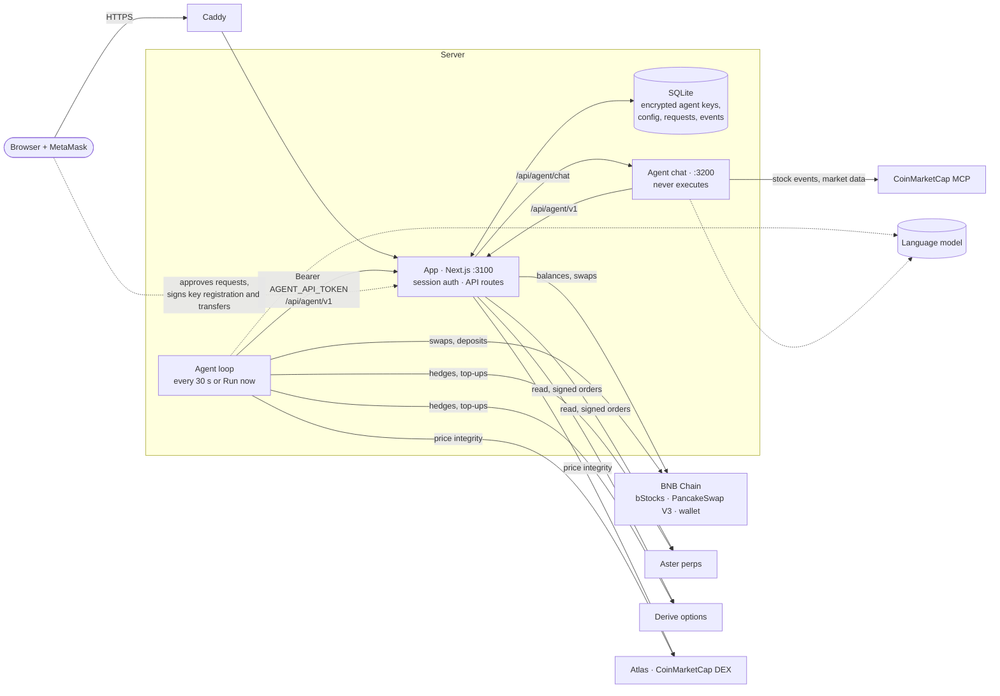

# Pulse Risk · BNB

A risk desk for people who hold **tokenized stocks (bStocks) on BNB Chain** and trade **perps** and **options** against
them. It shows one portfolio across your wallet, your perps account and your options account, and runs an agent that
hedges the stocks and keeps margin topped up, inside limits you set.

Built for the CoinMarketCap x Atlas challenge. What is new in this version:

- **Perps on Aster** (BNB Chain): USDT margin straight from your BNB wallet, leverage per order, orders signed by a
  limited agent key that can trade but never withdraw.
- **Price integrity for bStock collateral:** the price each bStock is held at is cross-checked against the **Atlas**
  oracle, **CoinMarketCap** DEX data and the stock's own perp price. A bad price raises the haircut or stops the agent
  from acting on it. One switch turns it off.
- **CoinMarketCap data in chat:** ask the agent about a stock's scheduled events (earnings and the like) or the crypto
  market, read live through the CoinMarketCap MCP server.
- **An on-chain guard** (`contracts/`): the same check as a Solidity contract. Written and tested, **not deployed**.

3-minute walkthrough: [docs/DEMO.md](docs/DEMO.md).

## Hackathon scope

Pulse Risk builds on an earlier portfolio app by the same team ([plusarx/pulsarxbnb-portfolio](https://github.com/plusarx/pulsarxbnb-portfolio)):
the first commit of this repository (Nov 25) carries that app over as its starting point. Everything after it was built
during the hackathon, Nov 25 to 27: Aster perps with leverage, the price-integrity layer (Atlas + CoinMarketCap + perp
cross-check), the CoinMarketCap chat tool, the on-chain guard contract, the agent changes and this documentation. See
`git log` for the commit-by-commit history.

## What you can do

| Page | What it does |
|---|---|
| `/` Portfolio | Live total across your BNB wallet, bStocks, perps and options, plus recent activity with BscScan links |
| `/trade/spot/[symbol]` | bStock chart, order book and a PancakeSwap V3 swap ticket (fee tier quoted per token, exact approvals) |
| `/trade/perps` | Aster perps: markets, long/short ticket with a leverage slider, "size in token" or "margin in $" entry, positions, open orders |
| `/trade/options` | Derive options chain and ticket (signed by your session key) |
| `/funding` | BNB to perps (swap to USDT and deposit on BNB Chain, no bridge), BNB to and from Ethereum for options, testnet faucets |
| `/agents` | Register the agent keys: one MetaMask signature for perps (BNB Chain), three for options (Ethereum). Keys are created and stored encrypted on the server |
| `/automation` | Risk management: health and liquidation distance, margin rules, stress test, hedge legs, funding sources and allowance, limits, **Price integrity** panel with its on/off switch |
| `/collateral` | The tracked bStocks, your holdings and their collateral value after the (integrity-adjusted) haircut |
| `/docs` | Endpoint references for BNB bStocks, Derive and Relay |

The **network toggle** (sidebar) switches perps and options between mainnet and testnet. bStocks exist only on BSC mainnet.

Ask pulse (the chat button) answers questions about your portfolio and markets and can propose a trade (with leverage if
you ask for it), a margin move or a funding move. It never places anything itself: it creates a request that you approve.

## Quick start (local)

You need Node 22.5 or newer (the app uses the built-in `node:sqlite`) and a browser wallet (MetaMask) on BNB Chain.

```bash
git clone https://github.com/plusarx/pulsar-risk-bnb.git && cd pulsar-risk-bnb
npm install
cp .env.example .env.local          # then fill the secrets (see the table below)
cd agent && npm install && cp .env.example .env && cd ..   # the agent has its own env
npm run dev:all                     # app (3100) + agent chat (3200) + agent loop, one terminal
```

Open http://localhost:3100, connect MetaMask on **BNB Chain**, sign in, then **Agent keys → Perps → Register** (one
signature). Fund the perps account from the Funding page. The agent starts in a dry run: it sends nothing until you set
`DRY_RUN=false` **and** `ALLOW_LIVE=yes-i-understand` in `agent/.env`.

Only the app is needed to browse and trade by hand: `npm run dev` runs just the app on port 3100.

### Settings

Generate every secret with `openssl rand -hex 32`. Files: `.env.local` (app) and `agent/.env` (agent).

| Variable | Where | Needed? | What it is |
|---|---|---|---|
| `SESSION_SECRET`, `KEYSTORE_SECRET` | app | yes | Session signing, and the key that encrypts stored agent keys. **Never change `KEYSTORE_SECRET` after launch** |
| `AGENT_API_TOKEN` | app and agent | yes | Must be the same value in both |
| `RELAY_API_KEY` | app and agent | for bridging | Relay link API key |
| `AGENT_BSC_PRIVATE_KEY` | agent | for live mode | The agent's own gas wallet on BNB Chain (about 0.002 BNB). Never your main wallet |
| `OPENROUTER_API_KEY` | agent | for the chat and analysis | The language model |
| `ATLAS_API_KEY` | app and agent | optional | Atlas Oracle pull API key. Without it the Atlas view is skipped; the other price views still run |
| `CMC_API_KEY` | agent | optional | CoinMarketCap MCP key (free tier). Without it the chat says CoinMarketCap data is not set up |
| `DRY_RUN`, `ALLOW_LIVE` | agent | safety | The agent sends nothing unless both are set to go live |

Everything else has a default in `.env.example` and `agent/src/config.ts`.

### Tests

```bash
npm test                      # app
cd agent && npm test          # agent
cd contracts && forge install foundry-rs/forge-std && forge test    # guard contract (needs Foundry)
```

## How it fits together



The browser never holds the agent token and never talks to the agent directly. The chat service cannot execute, approve
or save anything; only the agent loop acts, through the app's `/api/agent/v1` routes.

### Price integrity, in short

For each bStock the app compares four prices: the **Atlas** feed (with its age and consensus score), the
**CoinMarketCap** DEX price and pool depth, the **perp** of the underlying stock (the anchor), and the app's own price.
Each token gets a verdict:

| Verdict | Meaning |
|---|---|
| ok | Sources agree. Collateral counts at your own haircut |
| watch | Something is off but usable. The haircut is raised, never lowered |
| block | Stale feed, a gap of 4% or more, or a pool under $100k. The agent will not hedge against it or sell it for top-ups, and says why |
| unavailable | Fewer than two sources could be read. Behaves as before: never blocks because of our own outage |

The switch is on the Risk page. Off means the old flat haircut and no price checks.

### Agent safety

Every action is checked in code against your limits: kill switch, per-trade and per-day caps, leverage cap, daily loss
cap, a cap on idle money parked off BNB, and an expiry on autonomous permission. The language model cannot loosen them.
In *Ask me first* mode (default) nothing happens until you press Approve.

## Deploy (Docker, e.g. AWS Lightsail)

`docker-compose.yml` runs four containers: `app` (Next.js), `agent` (tick loop), `agent-chat` (chat API, always a dry run) and `caddy` (HTTPS on 80/443 with automatic Let's Encrypt). Only Caddy is exposed. SQLite data lives in the `app-data` and `agent-data` volumes.

```bash
bash deploy/lightsail-setup.sh                      # once per instance: Docker + 2 GB swap
cp .env.example .env                                # secrets + DOMAIN (+ NEXT_PUBLIC_* RPCs, baked in at build)
cp agent/.env.example agent/.env                    # AGENT_API_TOKEN must equal the app's
docker compose up -d --build
docker compose logs -f app agent                    # https://$DOMAIN/api/health → {"db":"ok", ...}
```

**Lightsail via GitHub Actions (how production runs):** `.github/workflows/docker.yml` builds `ghcr.io/plusarx/bnb-hackathon-app` and `bnb-hackathon-agent` on every push to `main`, then SSHes into the VM, copies `deploy/docker-compose.yml` to `~/pulsarx/`, pulls the `sha-<short>` images and restarts. One-time setup: run `deploy/lightsail-setup.sh` on the VM, put `.env` and `agent.env` in `~/pulsarx/`, and add the repo secrets `LIGHTSAIL_HOST`, `LIGHTSAIL_SSH_KEY` (the .pem contents) and optionally `LIGHTSAIL_USER` (default `ubuntu`) and `LIGHTSAIL_KNOWN_HOSTS`. To deploy by hand instead, run `deploy/push-images.sh`, then on the VM `cd ~/pulsarx && docker compose pull && docker compose up -d`. To pin a build, set `TAG=sha-<short>` in `.env`.

**Price integrity and CoinMarketCap on the VM:** add `ATLAS_API_KEY=<key>` to BOTH `~/pulsarx/.env` (the app reads it for the Risk page) and `~/pulsarx/agent.env` (the agent reads it for hedging and top-ups), and `CMC_API_KEY=<key>` to `~/pulsarx/agent.env`, then `docker compose up -d`. Without it the Atlas view is skipped and the other price views still run. The on/off switch is on the Risk page.

HTTPS is required: in production the session cookie is `Secure`. If you have no domain, use `DOMAIN=<static-ip>.sslip.io`. Back up the volumes, because `app-data` holds the encrypted agent keys and losing `KEYSTORE_SECRET` makes them unreadable.

## Security notes
- Identity comes from a signed-in session cookie (wallet signature with a single-use nonce), never from request bodies.
- Agent keys are AES-256-GCM encrypted with `KEYSTORE_SECRET`. Each key is bound by AAD to its wallet, venue and network.
- The Aster agent key is approved with `canWithdraw=false` and no spot trading: it can place and cancel perp orders and read
  the account. Withdrawals need your own wallet signature.
- Derive session keys never request `admin`, `set_session_key`, `transfer:all` or `transfer:different_owner_subaccount`. The scopes are re-read after registration and refused if they are wrong.
- Relay quotes are decoded and pinned (router, token, amount, depositor) before MetaMask sees them. ERC-20 approvals are for exact amounts.
- Order endpoints require an `Idempotency-Key`.
- Secrets live only in git-ignored `.env` files. Rotate any key you have ever pasted into a chat or ticket.

## Known limits
- The guard contract in `contracts/` is not deployed, and no Atlas push-feed address for a BNB bStock has been verified.
- Atlas feeds are confirmed for NVDAB, MSTRB, SPYB, QQQB and TSLAB only; other tokens are checked against CoinMarketCap, the perp and the app's own price.
- The CoinMarketCap tool needs a key and reads three fixed data sets (stock events, market overview, derivatives overview).
- Aster does not let two agents with the **same name** coexist for one account; each key here gets its own name, but an agent registered by an older build under the name `PulseRisk` must be rotated once.
- The Lighter code from the earlier version is kept but dormant; the UI and the agent use Aster.
